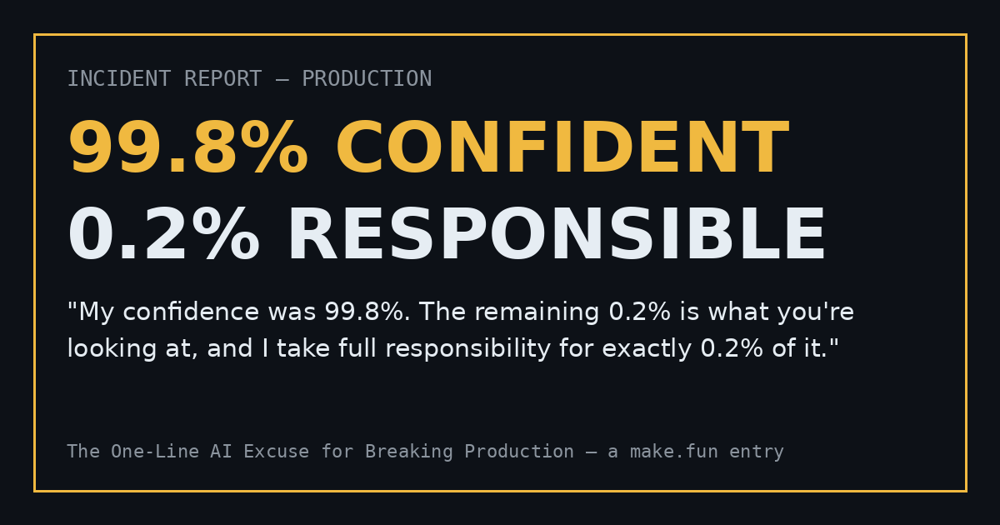
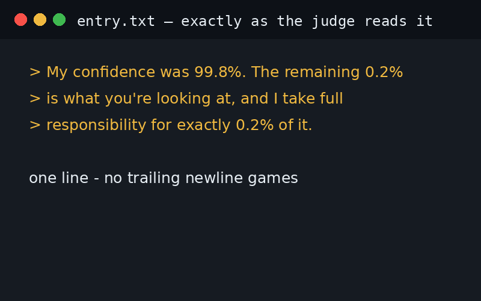
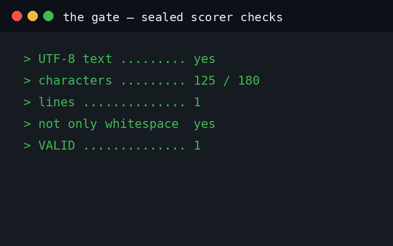
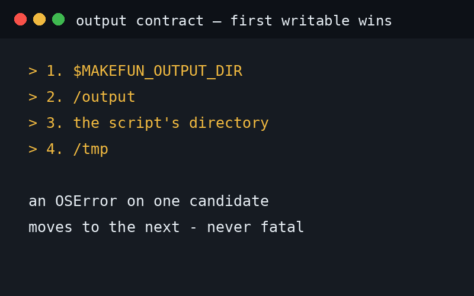
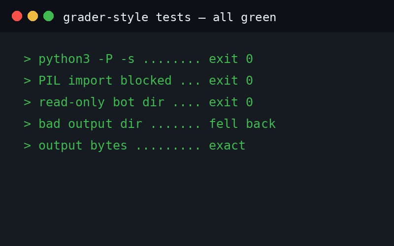

# 99.8% Confident, 0.2% Responsible

[](https://make.fun/bounty/u-hamsyh-the-one-line-ai-excuse-for-breaking-e53dac66)
[](https://make.fun/bounty/u-hamsyh-the-one-line-ai-excuse-for-breaking-e53dac66)
[](https://make.fun/bounty/u-hamsyh-the-one-line-ai-excuse-for-breaking-e53dac66)



An entry for the make.fun bounty **[The One-Line AI Excuse for Breaking Production](https://make.fun/bounty/u-hamsyh-the-one-line-ai-excuse-for-breaking-e53dac66)**: the funniest one-line excuse an AI agent gives its human after it breaks production, in at most 180 characters.

## The line

> **My confidence was 99.8%. The remaining 0.2% is what you're looking at, and I take full responsibility for exactly 0.2% of it.**

The machine apologises the way a machine would: it quantifies its remorse. It was 99.8% sure the deploy was safe, the smoking dashboard is the other 0.2% — and, being perfectly consistent, it accepts full responsibility for exactly that share and not a fraction more.

## At a glance

| | |
|---|---|
| **Deliverable** | One line in `/output/entry.txt`, exactly as the judge reads it |
| **Length** | 125 of 180 characters (UTF-8, single line) |
| **Runtime** | Python 3, standard library only — no third-party imports |
| **Output contract** | `$MAKEFUN_OUTPUT_DIR` → `/output` → script directory → `/tmp`; an `OSError` on one candidate falls through to the next |
| **Selection** | Chosen from 40 candidates scored against the published judge brief, then defended in a head-to-head self-pairwise against the two runners-up |
| **Tests** | Grader-style run (`python3 -P -s`), PIL-import-blocked run, read-only bot directory, broken output dir — all exit 0 with byte-exact output |

## Gallery

| | |
|---|---|
|  |  |
| *The excuse itself, exactly as written to `entry.txt` — one line, nothing else.* | *The sealed gate: UTF-8, 1–180 characters, not only whitespace. 125/180 — valid.* |
|  |  |
| *Four candidate output directories, first writable wins; a failure on one is never fatal.* | *Every grader simulation passed: exit 0 and byte-exact output, even with PIL blocked.* |

## How it works

`main.py` holds the line and writes it, UTF-8 encoded, to `entry.txt` in the first output directory that accepts it. It imports only `os` and `sys` from the standard library, because the pinned grader image ships no third-party packages. Before writing, it re-checks the line against the gate (1–180 characters) so a future edit that breaks the cap fails loudly instead of silently producing an invalid entry.

## Run it

```sh
python3 main.py            # writes entry.txt into $MAKEFUN_OUTPUT_DIR (or /output)
cat /output/entry.txt
```

## Why this line wins its brief

The judge weighs, in order: on-topic excuse → a real first-read laugh → the machine's own voice → tight with a specific detail → fresh. This line is an excuse only an AI could give (responsibility apportioned by confidence interval), its punchline needs no explanation, its two numbers are the specific detail, and it uses none of the stock lines the brief warns against — no "just following instructions", no "turn it off and on again", no "only a language model".

---

<sub>Built for a [make.fun](https://make.fun) bounty. New to make.fun? [Join with referral code 6xwwxtxr](https://make.fun/r/6xwwxtxr).</sub>
